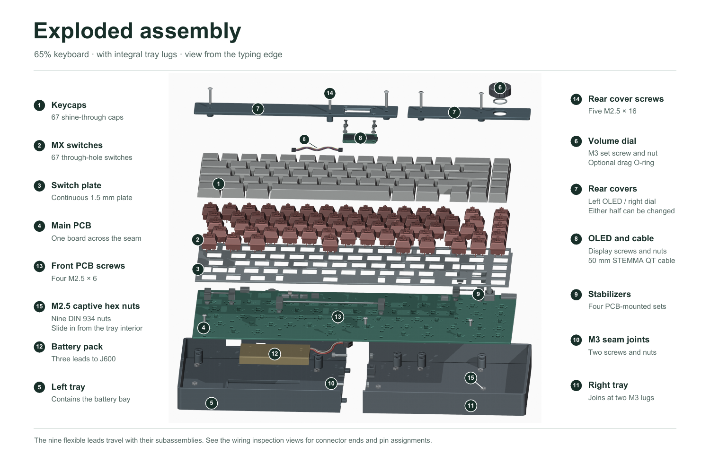
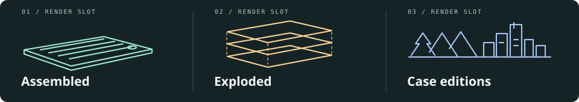

# mechKeyboard

**67 keys · USB-C + Bluetooth LE · a case you can print in PLA**

How far can AI take a keyboard from a sketch to a set of build files? This is the workbench. Lift the rear cover and you'll find an OLED harness, a rechargeable cell and a low-profile volume dial. Under WASD there's a haptic actuator. Every key gets its own reverse-mounted RGB pixel.

[**Pick up the design →**](HANDOFF.md) · [**Read the schematic →**](electronics/keyboard-schematic.pdf) · [**Explore the case →**](mechanical/sculpted-cases.pdf)

*Exploded assembly from the FreeCAD fit study. The assembly guide and mounting sections show the fasteners and stack heights.*

> **Rev F • Before PCB placement.** The schematic, editable case models and review evidence are here. The electrical review holds placement on three power-path decisions. PCB routing, Gerbers, firmware and hardware validation are still ahead. [Read the handoff](HANDOFF.md)

## Inside the design

| | Design | Open it |
|---|---|---|
| **Keys & light** | US ANSI 65%, 67 hand-soldered MX switches, per-key RGB for shine-through caps | [Keybed](design/keybed.md) · [RGB power](design/rgb-power.md) |
| **Radio & USB** | BMD-340 with nRF52840, physical transport selector, USB-C at 5 V with source-current detection | [Controller](design/controller-and-pins.md) · [USB input](design/usb-input-transient.md) |
| **Controls & feedback** | I²C OLED, top-right analog volume dial, haptics near WASD | [Display & volume](design/display-and-volume.md) · [Haptics](design/haptics.md) |
| **Case & plate** | Split PLA tray for a Flashforge Adventurer 5M, captive hex nuts, separate 1.5 mm steel switch plate | [Assembly guide](mechanical/assembly-guide.pdf) · [Screw sections](mechanical/mounting-sections.pdf) · [Plate DXF](mechanical/switch-plate/switch-plate-1p5mm.dxf) |
| **Assembly** | JLCPCB SMT assembly planned, with switches, potentiometer and actuator handled separately | [Electronics assembly split](design/assembly-stock.md) · [Mechanical BOM](design/mechanical-bom.csv) |

## Blender render gallery

| Planned shot | What to show | Future image |
|---|---|---|
| **Assembled** | Front three-quarter view with legends, dial and OLED visible | `docs/renders/assembled.webp` |
| **Exploded** | Plate, PCB, battery and captive hardware along the assembly axis | `docs/renders/exploded.webp` |
| **Case editions** | Alpine Pass and Elevated City side by side, with raking light across the relief | `docs/renders/editions.webp` |

The current [FreeCAD case gallery](mechanical/sculpted-cases.pdf) shows both editions. Their [print sets](mechanical/sculpted-cases/README.md) include the shared OLED carrier and support-free print orientations.

## On the workbench

- **KiCad** — Open the project with its local symbol and footprint libraries. The PDF is the quickest way to walk the eleven sheets. [Project](electronics/keyboard.kicad_pro) · [Schematic PDF](electronics/keyboard-schematic.pdf)
- **FreeCAD** — Start with the assembled keyboard, then look at service motions, cable access and the key stack. [Assembly](mechanical/keyboard-placement.FCStd) · [Mechanical review](mechanical/mechanical-review.pdf) · [Wiring inspection](mechanical/wiring-inspection.pdf)
- **Design review** — Follow each finding back to its reference, limit and operating state. [19-item register](design/prelayout-review.md) · [Electrical audit](design/rev-f-electrical-audit/review.md) · [Filterable workbook](design/rev-f-electrical-audit/electrical-audit.xlsx) · [Datasheet index](datasheets/README.md)
