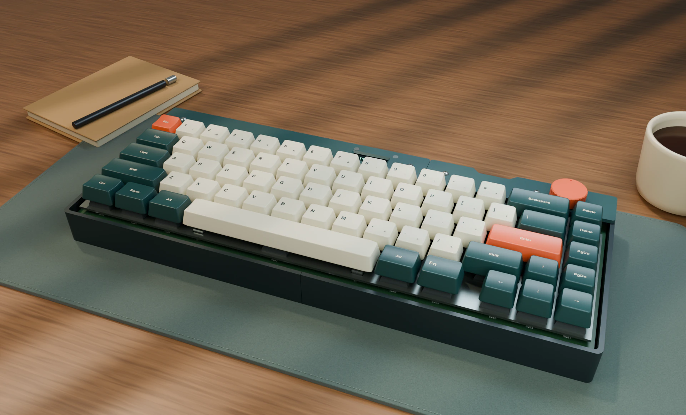
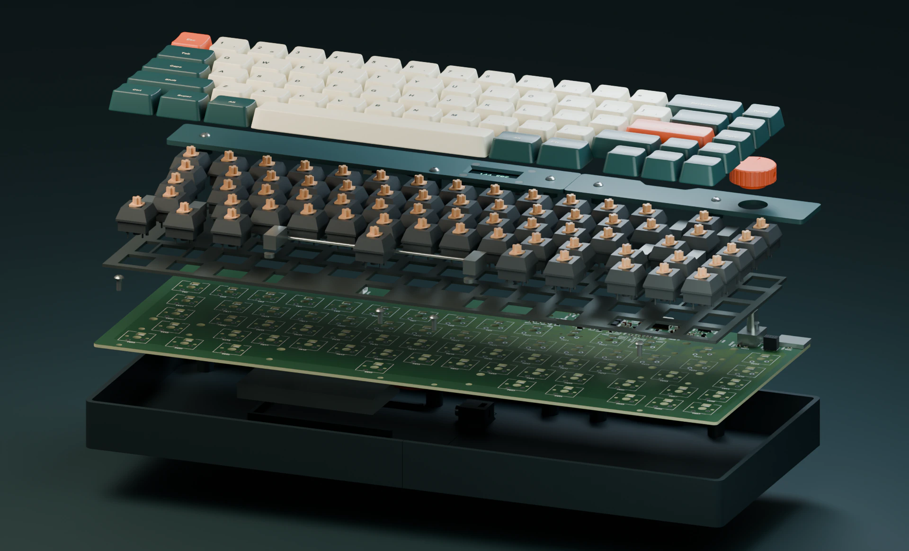
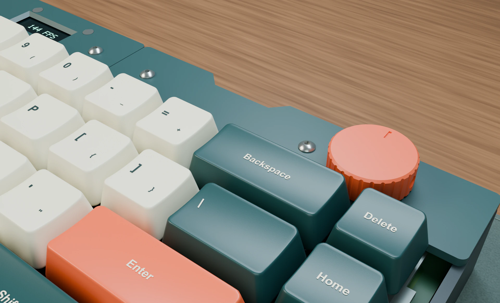
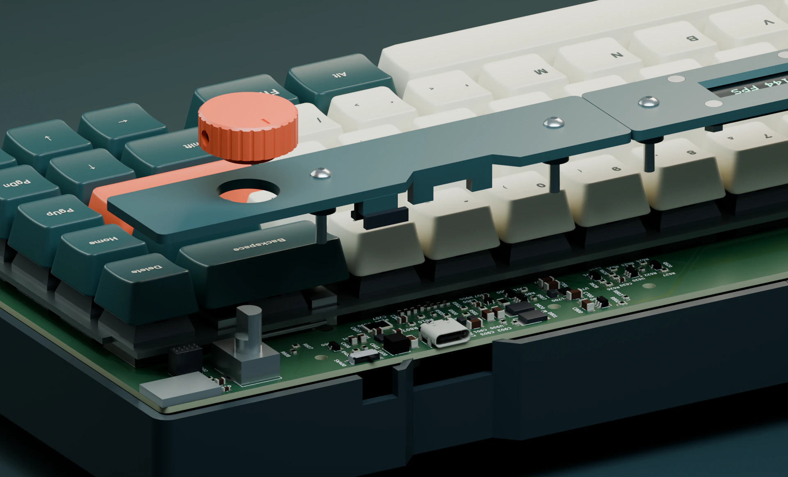
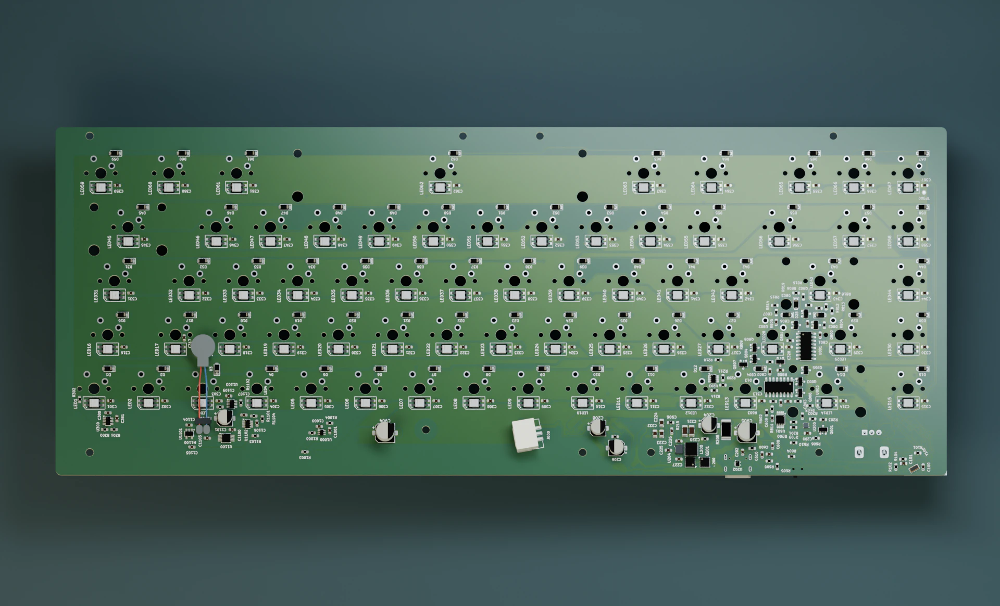
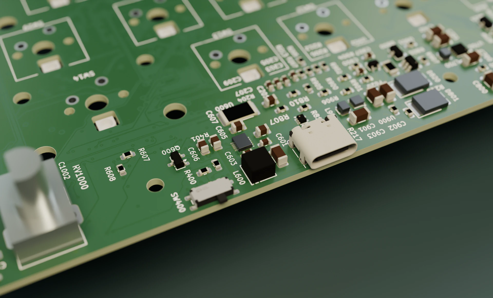
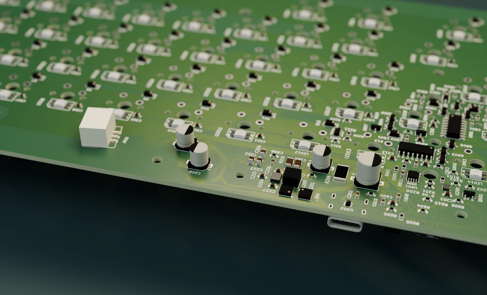
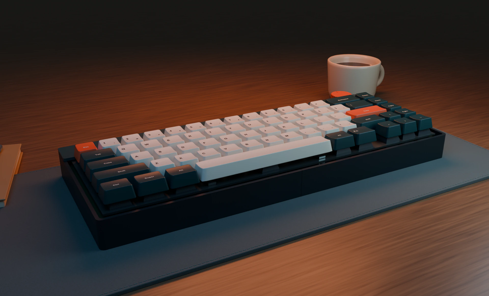

# mechKeyboard

**67 keys · USB-C + Bluetooth LE · a case you can print in PLA**

How far can AI take a keyboard from a sketch to a set of build files? This is the workbench. Lift the rear cover and you'll find an OLED harness, a rechargeable cell and a low-profile volume dial. Under WASD there's a haptic actuator. Every key gets its own reverse-mounted RGB pixel.

[**Pick up the design →**](HANDOFF.md) · [**Read the schematic →**](electronics/keyboard-schematic.pdf) · [**Explore the case →**](mechanical/sculpted-cases.pdf)

> **Rev F handoff • Before PCB placement.** The schematic, editable case models and review evidence are here. The electrical review holds placement on three power-path decisions. PCB routing, Gerbers, firmware and hardware validation are still ahead. [Read the handoff](HANDOFF.md)

## Inside the design

| | Design | Open it |
|---|---|---|
| **Keys & light** | US ANSI 65%, 67 hand-soldered MX switches, per-key RGB for shine-through caps | [Keybed](design/keybed.md) · [RGB power](design/rgb-power.md) |
| **Radio & USB** | BMD-340 with nRF52840, physical transport selector, USB-C at 5 V with source-current detection | [Controller](design/controller-and-pins.md) · [USB input](design/usb-input-transient.md) |
| **Controls & feedback** | I²C OLED, top-right analog volume dial, haptics near WASD | [Display & volume](design/display-and-volume.md) · [Haptics](design/haptics.md) |
| **Case & plate** | Split PLA tray for a Flashforge Adventurer 5M, captive hex nuts, separate 1.5 mm steel switch plate | [Assembly guide](mechanical/assembly-guide.pdf) · [Screw sections](mechanical/mounting-sections.pdf) · [Plate DXF](mechanical/switch-plate/switch-plate-1p5mm.dxf) |
| **Assembly** | JLCPCB SMT assembly planned, with switches, potentiometer and actuator handled separately | [Electronics assembly split](design/assembly-stock.md) · [Mechanical BOM](design/mechanical-bom.csv) |

## Blender render gallery

### Under the keycaps

The steel plate holds the switches above the PCB. The cell sits in the left half of the tray and is drawn forward here to reveal it. [FreeCAD exploded study](mechanical/exploded-assembly.png) · [Assembly guide](mechanical/assembly-guide.pdf)

| The assembled controls | The rear cover lifted |
|---|---|
|  |  |

### The populated board

| USB-C and the rear controls | Underside power circuitry |
|---|---|
|  |  |

These renders show the later six-layer layout. The Blender scene uses the saved right-rear PCB for placement, outer copper, pads, solder mask and silkscreen. KiCad supplied 399 component models. The remaining fitted parts use mechanical CAD or representative package bodies, including the 67 MX switches. The test pad and board outline have no separate assembly body. The sculpted caps follow the project's key centers and widths. Colors, legends and desk lighting are render choices. [Key layout](mechanical/key-centers.csv)

The USB-C model is by Adom Industries Inc. and the upstream KiCad contributors. The display model is by Adafruit. [USB-C model source](https://wiki.adom.inc/adom/type-c-31-m-12/files/type-c-31-m-12.step) · [USB-C model license](https://creativecommons.org/licenses/by-sa/4.0/) · [Display model license](mechanical/vendor/Adafruit-LICENSE.txt)

### After hours

The [FreeCAD case gallery](mechanical/sculpted-cases.pdf) also shows the Alpine Pass and Elevated City editions and their [print sets](mechanical/sculpted-cases/README.md).

## On the workbench

- **KiCad** — Open the project with its local symbol and footprint libraries. The PDF is the quickest way to walk the eleven sheets. [Project](electronics/keyboard.kicad_pro) · [Schematic PDF](electronics/keyboard-schematic.pdf)
- **FreeCAD** — Start with the assembled keyboard, then look at service motions, cable access and the key stack. [Assembly](mechanical/keyboard-placement.FCStd) · [Mechanical review](mechanical/mechanical-review.pdf) · [Wiring inspection](mechanical/wiring-inspection.pdf)
- **Design review** — Follow each finding back to its reference, limit and operating state. [19-item register](design/prelayout-review.md) · [Electrical audit](design/rev-f-electrical-audit/review.md) · [Filterable workbook](design/rev-f-electrical-audit/electrical-audit.xlsx) · [Datasheet index](datasheets/README.md)
