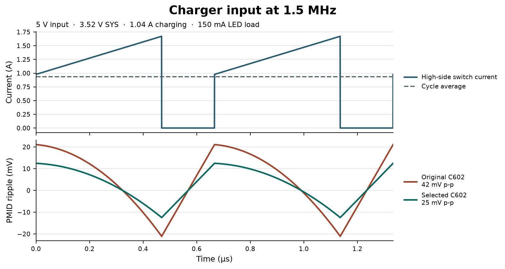

# Charger input ripple and load steps

**C602 on PMID is Samsung CL31A106KBHNNNE, JLCPCB Basic C13585, 10 µF / 50 V X5R in 1206. C601 remains at 1 µF on the charger VBUS pin and C603 remains at 100 nF on PMID.** Samsung's typical curves give 7.28 µF at 5 V for the new bulk capacitor and 4.26 µF for the previous 10 V, 0805 part. Under the modeled full-charge-plus-lighting load at low SYS, this reduces the capacitive component of PMID ripple from 42 mV to 25 mV peak-to-peak. The footprint becomes 3.2 × 1.6 mm. The voltage rating was selected for its bias performance on the keyboard's 5 V supply. [Original Samsung part](https://product.samsungsem.com/mlcc/CL21A106KPFNNN.do) · [Selected Samsung part](https://product.samsungsem.com/mlcc/CL31A106KBHNNN.do) · [JLCPCB basic SMT listing](https://jlcpcb.com/partdetail/C13585) · [LCSC supply](https://www.lcsc.com/product-detail/C13585.html)

## Which capacitor carries which current?

C601 connects from VBUS_LIMITED to ground at U600 pin 18. Internal reverse-blocking Q1 connects this node to PMID, pin 17. C602 and C603 connect from PMID to GND, pin 15. In forward buck mode, internal Q2 chops PMID into SW and L600 feeds SYS. When Q2 opens, internal Q3 carries the inductor current. The high-frequency current that changes path at each edge circulates through C603/C602, Q2, Q3 and the local ground return. U800, the front-end switch and the USB cable carry the mean current and some residual ripple. Their impedance, including interconnect inductance, sets the actual split. TI recommends 1 µF nominal at VBUS and 10 µF nominal at PMID before derating. Its schematic adds 100 nF on PMID. [TI BQ25622, §§6–7, 9.2 and 11.1](https://www.ti.com/lit/ds/symlink/bq25622.pdf)

The connector-side RC damping branch handles cable ringing at insertion and live source transitions. C601 supports the charger-side VBUS node downstream of U800. C602 and C603 support the switching node’s local input. When the upstream switches conduct, ripple and load steps can propagate all the way back to the receptacle. During cold turn-on, include the charging of PMID in U800's load. Q1 has its source at VBUS and its drain at PMID, so even its body diode can charge an initially empty PMID in the forward direction. U600 separately ramps IINDPM during SYS startup. Holding charge enable inactive allows adapter-powered SYS operation. [TI BQ25622, §§6 and 8.3.3](https://www.ti.com/lit/ds/symlink/bq25622.pdf)

## Switching ripple

The calculation uses continuous conduction, 1.04 A programmed battery current, 0.12 W base system power and 85% efficiency for a 5 V, 150 mA LED load. Voltages in the table are **at the converter**, after switch and wiring losses. In the ideal buck approximation, duty D = VSYS / VPMID, average inductor current I = ICHG + (0.12 W + PLED / 0.85) / VSYS, and triangular inductor current swing ΔI = VPMID × D × (1 − D) / (f × L). For an upstream source delivering the average over a cycle, the input bank's RMS AC current is √[I²D(1 − D) + DΔI²/12]. This includes inductor ripple and system load in addition to TI's first-order charging estimate. The model integrates the high-side on-current to find the charge swing, then divides by the effective C602 + C603. [TI BQ25622, §9.2.2](https://www.ti.com/lit/ds/symlink/bq25622.pdf) · [Reproduce the calculations](charger-input-model.py)

| PMID / SYS | Lighting | Inductor average / p-p | Local AC current | Original / selected PMID ripple p-p |
|---|---|---:|---:|---:|
| 5.00 / 3.52 V | Off | 1.074 / 0.695 A | 0.518 A RMS | 34 / 20 mV |
| 5.00 / 3.52 V | 150 mA | 1.325 / 0.695 A | 0.628 A RMS | 42 / 25 mV |
| 5.00 / 4.18 V | 150 mA | 1.280 / 0.457 A | 0.489 A RMS | 27 / 16 mV |
| 4.75 / 4.18 V | 150 mA | 1.280 / 0.334 A | 0.426 A RMS | 20 / 12 mV |
| 5.50 / 3.52 V, sensitivity case | 150 mA | 1.382 / 1.173 A | 0.716 A RMS | 85 / 49 mV |

The first four rows use typical room-temperature capacitance, 1 µH and 1.50 MHz. The last row uses 1.097 A charge current, 0.80 µH, 1.35 MHz and 70% of typical biased capacitance in both capacitors. The 70% multiplier is an explicit allowance to explore variation in small-signal drive, temperature, initial tolerance and aging. Samsung's bias characterization uses 1 kHz and 1 Vrms at 25 °C. These calculations cover the PWM charge regime. Constant-voltage taper, PFM at light load, layout-induced voltage spikes and converter control-loop interaction require separate treatment. The screened peak inductor current is 1.97 A. Coilcraft lists 4.8 A at 10% incremental inductance loss for L600. [Samsung capacitor characterization](https://product.samsungsem.com/mlcc/CL31A106KBHNNN.do) · [Coilcraft XGL4030-102](https://www.coilcraft.com/en-us/products/power/shielded-inductors/molded-inductor/xgl/xgl4030/xgl4030-102/)

At 1.5 MHz, Samsung's typical unbiased model gives C602 ESR near 4.46 mΩ. Treating the entire 0.716 A waveform as flowing through that resistance gives 2.3 mW. ESR varies with frequency and temperature, and each branch has its own impedance. Samsung's nearest published ripple heating curve, at 800 kHz, shows about 5 °C rise at 2.57 A RMS under its test conditions. These data support the part choice while leaving broadband edge stress and final board temperature to the routed layout. Place C603 first beside pins 17 and 15, then C602 beside C603, with a short same-layer ground return. Keep the 1 µF C601 at pin 18. Even 1 nH shared inductance produces 100 mV at an illustrative 0.1 A/ns edge. [Samsung ESR and ripple heating](https://product.samsungsem.com/mlcc/CL31A106KBHNNN.do) · [TI layout, §11 and Figures 11-1 to 11-4](https://www.ti.com/lit/ds/symlink/bq25622.pdf)

The plot shows the capacitive voltage excursion around the midpoint of each trace. The separate impedance model includes ESR, ESL, 10 ns edges and 25 switching harmonics. At the same operating point it gives **61 mV peak-to-peak at PMID**, approximately **0.613 A RMS through C602**, **0.152 A RMS through C603** and **0.15 mA RMS in the cable** within that modeled frequency band. The edge result is sensitive to the board layout and capacitor parasitics. [Network model and results](usb-input-transient.md)

## What reaches the cable during charging?

For one illustrative revision-D network at 5 V, 3.52 V SYS and full permitted lighting, the model gives **501 mA RMS** in the first switching harmonic at Q2. With the selected capacitor it gives approximately **497 mA** in C602, **4.7 mA** in C603, **27 mA** in C601, **0.97 mA** in the connector damping resistor and **0.15 mA** in the cable at that harmonic. The three-capacitor reservoir carries about 3.6 mA and C800 carries 51 mA at this frequency. With original C602 the modeled cable contribution is 0.30 mA. These are complex currents at 1.5 MHz, so magnitudes need not sum arithmetically. C603 becomes more important at higher harmonics. The cable's *DC* input current is much larger. For example, (1.04 A × 4.18 V + 0.12 W + 0.75 W / 0.85) / (4.75 V × 0.90) gives **1.25 A** with capped lighting and **1.05 A** with lighting off. Actual input current depends on voltage drops, input regulation, losses and battery state. [TI BQ25622 current regulation](https://www.ti.com/lit/ds/symlink/bq25622.pdf) · [Reproduce branch currents](charger-input-model.py)

The example uses a 0.70 µH / 0.15 Ω cable to an AC-stiff source, a 1 Ω / 4 µF connector damping branch, 0.825 µF each at raw VBUS and U600 VBUS, 7.276 µF at C800 on protected VBUS, 3–8 nH assumed per intervening switch path, and 0.5–0.8 nH per ceramic capacitor branch. The protected bulk branch uses 0.10 Ω external series resistance feeding three parallel 47 µF capacitors, with 0.04 Ω and 2 nH representative ESR and ESL for the combined bank and its connections. The conducting input MOSFET pair, U800 and Q1 contribute 20, 34 and 26 mΩ in this example. Q1's default on-resistance can depend on IINDPM, and U800's conducting resistance applies outside active current limit. Switch substitutions, PCB geometry, nonlinear limiting, regulator dynamics and cable/shield return paths change these currents. The example quantifies the distinction between PWM ripple and average draw. Conducted-EMI or current-limit margins require a routed network. [TI BQ25622 Q1_FULLON](https://www.ti.com/lit/ds/symlink/bq25622.pdf) · [TI TPS22950-Q1](https://www.ti.com/lit/ds/symlink/tps22950-q1.pdf) · [TI CSD17309Q3](https://www.ti.com/product/CSD17309Q3)

## Turn-on charge and load steps

At 5 V, C601's effective capacitance is approximately 0.825 µF. Integrating the typical C(V) curves from 0 to 5 V gives 4.70 µC for C601 and 45.48 µC for selected C602. Including 0.50 µC for C603 gives **50.68 µC downstream**, up from 41.96 µC. To 5.5 V the totals are 54.67 and 44.44 µC. At a fixed 34 mA available to these three capacitors, they reach 5 V in roughly 1.49 ms versus 1.23 ms. Bias curves are a screening approximation to differential capacitance. Actual cold-start sequencing includes U800's limited current, PHY and converter startup loads, SYS capacitance and logic loading. Evaluate the later switched charge during the applicable USB inrush observation window as well as the immediate attachment load. [C601 characteristic](https://product.samsungsem.com/mlcc/CL10B105KA8NFN.do) · [C602 characteristic](https://product.samsungsem.com/mlcc/CL31A106KBHNNN.do) · [USB-IF inrush interpretation](https://compliance.usb.org/index.asp?Format=Standard&UpdateFile=Electrical)

For a load step, the capacitor supplies the **current deficit** between the newly demanded current and what the upstream path supplies. If the selected 7.38 µF PMID bank alone covers a 0.25 A deficit for 1 µs or 5 µs at 5 V, its modeled droop is 34 mV or 169 mV. The previous bank gives 57 mV or 287 mV. A sustained 1 A deficit for 5 µs would demand about 0.68 V from the new bank. A small local bulk capacitor cannot carry that step for long. Program IINDPM for the qualified source, ramp charge current in steps with RGB off during qualification, and reduce LED/charge load when the source derates. TI documents the SYS start-up ramp and load priority. Its 5 µs figure for U800 applies to typical hard-short response, so it cannot establish a maximum charger load-step response. A battery connected to SYS through the BATFET can supply transient system power. Battery-free cold starts require their own budget. [TI BQ25622, §§8.3.3–4](https://www.ti.com/lit/ds/symlink/bq25622.pdf) · [TPS22950-Q1, §6.5](https://www.ti.com/lit/ds/symlink/tps22950-q1.pdf)

The charger-sheet change preserves the pad connections and changes the C602 part and land pattern. The numbers above are electrical models. Switching-node parasitics, harmonic current and temperature depend on PCB placement and copper geometry.
