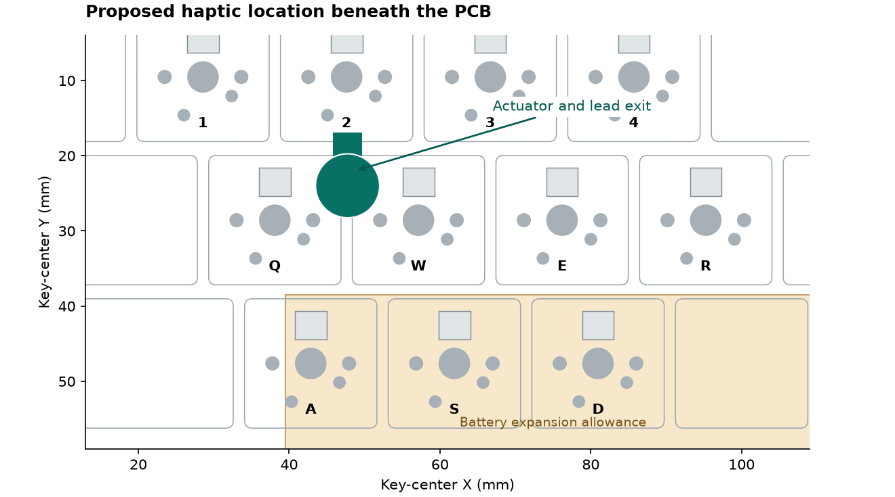

# WASD haptic option

**Revision F, 21 November 2026.** M1100 is a wired, Z-axis linear resonant actuator between Q and W. U1100 drives it from the charger’s SYS rail. U100 shares the I²C charger bus through a translator with powered-off protection.

## Sourcing and assembly

| Function | Part | LCSC retail on hand | Installation |
|---|---|---:|---|
| Actuator | LEADER LD0832AA-0099F, C2682305 | 999 | Apply the supplied tape to the PCB after reflow. Hand-solder the two AWG32 leads to separate motor-output pads and strain-relieve them. [LCSC](https://www.lcsc.com/product-detail/C2682305.html) · [Manufacturer drawing, p. 13](../datasheets/mechanical/LD0832AA-0099F.pdf) |
| Driver | TI DRV2605LDGSR, C527464 | 8,084 | 10-pin VSSOP, JLCPCB extended SMT. JLC showed 7,770 available under its in-stock ordering threshold. [LCSC](https://www.lcsc.com/product-detail/C527464.html) · [JLCPCB](https://jlcpcb.com/partdetail/C527464) · [TI datasheet](../datasheets/active/DRV2605L.pdf) |

Both retail quantities were read from exact-MPN LCSC inventory. The two single-unit base prices totaled about $2.42 before the translator, LDO, passives, assembly and shipping. The motor’s manufacturer specification gives 1.8 V RMS at 235 ±10 Hz and up to **90 mA RMS** on a 100 g jig. The LCSC parametric field says 80 mA. Set the rated output and overdrive clamp from the manufacturer limits and TI's LRA register equations. LEADER gives 1.9 V RMS as the top of the operating range. Its acceleration specification is for the jig. Keyboard acceleration and audible rattles remain unknown.

The TPS7A0218PDBVR LDO, C3748843, showed 1,805 LCSC pieces and 1,729 available through JLC SMT. The TCA9416DDFR translator, C4364143, showed 6,503 LCSC pieces and 6,777 available through JLC SMT. The C284840 tantalum showed 569 LCSC pieces and 576 available through JLC SMT. The BOM uses four of these tantalums including the three at USB input. Assembly stock reflects a dated observation and needs allocation at ordering. [LDO](https://www.lcsc.com/product-detail/C3748843.html) · [Translator](https://www.lcsc.com/product-detail/C4364143.html) · [Bulk capacitor](https://www.lcsc.com/product-detail/C284840.html)

## Underside placement

The center is **(47.75, 24.00) mm** in key-center coordinates, 10.45 mm from the W stem. FreeCAD uses Y = −24.00 mm. The fit check used an 8.50 mm diameter × 3.90 mm deep envelope (including allowances for adhesive and foam) and a 3.90 mm wide lead-exit reservation extending 7.10 mm from the center toward the USB edge. Both touch the PCB underside at Z = −1.60 mm. The body drawing gives Ø8.0 ±0.1 mm. Place the modeled B-side solder lands at (46.48, −5.00) and (49.02, −5.00) mm in key-center coordinates. Wire red to pad 1 (OUT+) and blue to pad 2 (OUT−). The resonant winding is AC-driven, and using the marked orientation keeps all assemblies consistent. Keep the adhesive area free of solder joints, exposed vias and assembly markings. Strain-relieve the insulated part of both leads at the rear shelf. [Mechanical fit and lead route](fit.md#haptic-actuator-and-battery-placement)

| Modeled feature | Shortest distance in FreeCAD |
|---|---:|
| Switch bodies, pins and pegs | 1.31 mm |
| Reverse-mounted LEDs | 2.21 mm |
| Expanded battery envelope | 10.25 mm |
| Left tray including guides and bosses | 8.90 mm |

Distances apply to the proposed body and lead exit in the current assembly, using the actuator envelope. The modeled 25–29 mm wire routes have a minimum 0.58 mm gap to the LED bodies. Final PCB placement, solder fillets and assembly tolerances still affect that gap. A/S/D project onto the battery clearance volume. Mounting beside W gives the actuator a direct mechanical path into the keybed. The installed bay, strap and guides are 2 mm to the right and 4 mm nearer the spacebar than the previous revision. Its three leads curve to the existing J600 header. [FreeCAD assembly](../mechanical/keyboard-placement.FCStd) · [Key centers](../mechanical/key-centers.csv)

## Rail sequencing and signal levels

SYS feeds both U1100 VDD pins and the TPS7A0218PDBVR. P1.04, U100 pad 60, is HAPTIC_EN. A hardware pulldown keeps the LDO disabled at reset. Its output supplies the translator’s A side and U1100 EN. The translator’s OE follows through the R1101/C1108 delay. VCCB uses the main 3.3 V rail. The LDO EN is rated independently of VIN, including when VIN is zero. DRV2605L signal pins are limited to VDD + 0.3 V absolute maximum, and TI specifies that bus highs remain within VDD. Powering the translator's A side from a local 1.8 V supply derived from SYS satisfies this with valid rails, including ordinary dropout as SYS falls. Disabling the LDO removes the A-side pulls and the translator isolates the haptic side while USB retention can still hold the charger bus at 3.3 V. Use at least 1 µF nominal ceramic at LDO input and output. Require effective output capacitance of at least 0.5 µF at bias and across tolerance and temperature. A local 1 µF at U1100 VDD and a separate 1 µF from REG to GND follow TI table 32. Route REG directly to the capacitor with a short return. [TI DRV2605L](../datasheets/active/DRV2605L.pdf) · [TPS7A02 datasheet](../datasheets/active/TPS7A02.pdf) · [TCA9416 datasheet](../datasheets/active/TCA9416.pdf)

The TCA9416 internal pullups are nominally 10 kΩ on each side. With both supplies up, the existing 4.7 kΩ controller pulls in parallel with the internal B pulls. At maximum normal rail voltages and minimum pull resistances, allow 1.4 mA total sinking per low line as a first check. Configure both nRF TWIM0 GPIOs for high-drive open drain (H0D1), Nordic specifies VOL ≤0.40 V at up to 5 mA. On the haptic side the pass-FET sees its own pullup current (≤0.25 mA) during a controller-driven low. Using 16 Ω from the typical curves gives <4 mV drop and roughly 96 mV to the DRV2605L 0.50 V low threshold. With the haptic IC driving its SDA ACK low, it guarantees VOL ≤0.40 V at 4 mA. Allow ≤1.2 mA on the shared side for about 19 mV pass drop at the same representative resistance. This is well below Nordic's 0.3 × VDD low threshold. The BQ25622 threshold is 0.42 V and its data frames are driven by Nordic on the same side without a translator drop. During haptic ACK the controller owns sampling. Verify shared-bus idle/start/stop behavior and low-state ground offset at maximum pull loads, especially as the LDO switches. TI only plots typical pass resistance. Preserve the existing 4.7 kΩ charger pulls and operate initially at 100 kHz. [TI haptic driver §6.5](../datasheets/active/DRV2605L.pdf) · [Nordic GPIO electrical specification](../datasheets/active/nRF52840.pdf) · [Charger I²C thresholds](../datasheets/active/BQ25622.pdf) · [TCA9416 Figure 6-1](../datasheets/active/TCA9416.pdf)

The TCA9416 specifies B-side supply current up to 7 µA when A is off and up to 0.5 µA powered-off I/O leakage per line at temperatures through 85 °C. DRV2605L shutdown current is up to 7 µA in the datasheet's stated 25 °C condition. The LDO adds up to 10 nA specified shutdown current at 25 °C and additional cold/hot variation. C1101's leakage limit is 7.5 µA at rated voltage and room temperature. Reserve these currents in the 50 µA battery standby target and the USB retention budget. The capacitor's leakage may rise with temperature. In the abrupt SYS-discharge or hard-short case the 1.8 V bypass can momentarily hold up EN and the A-side data pins. The LDO output discharge and converter behavior during that event need verification against DRV2605L VDD + 0.3 V, SYS rise/fall timing, and LDO reverse-current limits. Keep disabled during unqualified attach and rare power-path transitions. [TCA9416 §6.5](../datasheets/active/TCA9416.pdf) · [TPS7A02 output discharge](../datasheets/active/TPS7A02.pdf) · [AVX ratings](https://datasheets.kyocera-avx.com/TPS.pdf)

## Operating power

A hit has up to 0.162 VA of terminal apparent power at 1.8 V RMS and 90 mA RMS. Using 80% drive efficiency and including the driver and control-circuit overhead, reserve **0.22 W at the driver's supply**. This is a running allocation. Braking and switching require separate transient checks. SYS supplies the driver directly, so the allowance is about 69 mA at 3.2 V SYS or 51 mA at a 4.75 V USB connector with 90% upstream efficiency. A 50 ms hit once per second adds about 3.4 mA average at a 3.2 V cell with those assumptions.

Source policy follows **the fitted U800 limits**, which are lower than the USB current advertisements. Treat the historical 1.30 A connector-only calculation for a 1.5 A advertisement as an upper comparison. The fitted 1.5 A tier uses a 0.65 A planning ceiling behind the limiter, while the 3 A tier uses 1.30 A. [USB source-current limiter](usb-limit.md) · [Charger configuration](charge-control.md)

The planning model uses 4.45 V at the connector for the low-voltage screen, 90% upstream efficiency, 85% efficiency for OLED and RGB conversion, a 0.12 W system base, a fully active 35 mA OLED, a 0.22 W hit, 4.18 V programmed charge voltage, +5.5% illustrative charge current error, and 10 mA extra connector allocation for bypass loads. The +5.5% error is characterized by TI at 1.04 A under stated conditions. It is a provisional allowance at the other settings. Conservative power accounting includes the bypass allocation when comparing this connector estimate with U800's downstream allocation.

| State with haptics enabled | Charge setting | RGB limit at 5 V | Estimated connector current at 4.45 V |
|---|---:|---:|---:|
| Configured 500 mA host, 0.18 A planning limit | Off | Off | 0.129 A |
| 1.5 A Type-C advertisement, 0.65 A planning limit | 0.40 A | Off | 0.569 A |
| 3 A Type-C advertisement, 1.30 A planning limit | 0.80 A | 150 mA | 1.23 A |
| 3 A Type-C advertisement, 1.30 A planning limit, prioritize charging | 0.88 A | 125 mA | 1.28 A |

At 4.75 V the same model gives 1.24 A for 0.88 A charging and 150 mA lighting. Apply budget changes before accepting a hit, block overlapping OLED or RGB turn-on with haptics, keep EN low on unqualified attach and suspend, and return it low when the pack or USB state cannot support an effect. At low cable voltage BQ25622 VINDPM can reduce charging further, because its reset setting is 4.6 V on the charger side of the input protection and limiter. The examples express an upper load case near the end of constant-current charging. Guaranteeing connector and chip headroom still requires measured or modeled path loss and source transients.

The ideal 1500 mAh constant-current durations are 1.44 h at 1.04 A, 1.70 h at 0.88 A, and 1.88 h at 0.80 A, before taper. For the roughly two-hour goal, use the normal high-charge policy with haptics disabled or reassess charge, lighting and haptics together based on available source margin. The complete charge time is unresolved at this design stage.

## SYS bulk and transient screen

C1101 adds one polarized 47 µF, 16 V capacitor near U1100. It uses the same KYOCERA AVX TPSD476K016R0150 as the USB bank. The nominal SYS total rises from 42.1 µF to approximately 91.1 µF including new small bypasses. The charger specifies 20–500 µF on SYS under its stated capacitance conditions. The LED reservoir and USB input damping branch are on other rails. Follow the polarity-marked pad during placement. [TPS Series ratings table](https://datasheets.kyocera-avx.com/TPS.pdf) · [SYS capacitance by rail](usb-input-transient.md) · [BQ25622 recommended conditions](../datasheets/active/BQ25622.pdf)

Start with a 0.22 A incremental step at the driver. At zero back-EMF the 21.6 Ω minimum winding DC resistance and a 4.4 V SYS screening point suggest a 0.204 A full-supply current plus small driver overhead. Use this value for the initial switching transient. Sustained power and braking while the actuator is moving have separate budgets. With a local-only capacitor model, 42.3 µF at the −10% initial tolerance and 150 mΩ ESR give `ΔV ≈ ΔI × (ESR + Δt / C)` = **85 mV** at 10 µs, or 293 mV at 50 µs. The temperature-stability qualification test permits −10% cap change and 2.5× room ESR at −55 °C. Using those allowances in the same model gives 38.1 µF, 375 mΩ and **140 mV** at 10 µs, or 371 mV at 50 µs. ESR is specified at 100 kHz. These estimates omit route ESL, upstream impedance and the switching response. They show the range of transient sensitivity and do not establish a response time or a production limit. Place the ceramics at the driver and keep the bulk close to its supply and ground return. Validate power-up, arrest and current-limit behavior with the actual layout, especially as a low battery approaches cutoff. [AVX temperature stability and ESR](https://datasheets.kyocera-avx.com/TPS.pdf)

Also check positive SYS excursion at braking, interrupted effects and ordinary source load release. At 4.4 V with 42.3 µF local, a rise to 4.75 V corresponds to about 68 µJ of additional stored energy, and a rise to the driver's 5.2 V operating ceiling corresponds to about 162 µJ, before any immediate ESR jump. The datasheets do not bound recovered electrical energy for this actuator and mounting. The BQ25622 can sink a nominal 30 mA in SYS OVP during forward operation. Treat the battery-only path and its pack protector separately. Keep startup and braking within U1100's operating range and verify SYS, 3.3 V and charger flags under the worst allowed sequence. The first firmware release should use low intensity and enforce a cooldown until brake and transient margins are established. [Charger SYS overvoltage behavior](../datasheets/active/BQ25622.pdf) · [Driver braking control](../datasheets/active/DRV2605L.pdf)

## Firmware interface

The keyboard receives an effect ID and intensity from the game companion over wired USB or BLE. Run a bounded effect worker outside scan and HID paths. The worker uses TWIM0 at an initial 100 kHz, shares the bus lock with charging control, and addresses U1100 at 0x5A and U600 at 0x6B. With the translator off, R100 and R101 provide the existing 4.7 kΩ pulls. Including 1% resistor tolerance, the standard-mode 1 µs rise-time limit allows roughly 249 pF per line from (t_r = 0.8473 R C). Check rise time and low-state voltage after routing. A chip can acknowledge at 0x5A with EN low, even though register access is disabled. Count a valid register read after enable as the presence check. Leave the OLED on TWIM1. [TI driver, §8.5.3 and §8.4](../datasheets/active/DRV2605L.pdf) · [NXP I²C specification](https://www.nxp.com/docs/en/user-guide/UM10204.pdf)

P1.04 (module pad 60) drives HAPTIC_EN. Assert it only in a power-eligible state and wait for the 1.8 V rise, translator OE delay and driver startup before register access. The 100 kΩ and 100 nF OE network has a 10 ms nominal time constant and needs about 10.5 ms to reach the guaranteed high threshold after a step. Allow 20 ms from HAPTIC_EN initially, verify the actual startup window, and keep the branch armed during eligible gameplay to avoid adding this delay to every hit. On power downgrade, unplug, transport reset, or low cell, clear future events and deassert EN without waiting for I²C. In normal operation let the programmed effect brake before disabling. A failed calibration or I²C timeout leaves EN low and preserves keyboard input. Reapply and verify volatile configuration after EN is cycled until retained behavior is established. Share one power-arbitration state across OLED inrush, RGB startup, charge current and haptic playback.

Initialize U1100 in LRA closed-loop mode. Set the drive-time field to 16 for 2.1 ms, which approximates half a cycle at 235 Hz. Start with TI's 300 µs sampling setting, BRAKE_STABILIZER enabled and open-loop fallback disabled. For initial filtered-output settings, TI equation 5 with RATED_VOLTAGE = 0x44 gives 1.719–1.760 V RMS across 225–245 Hz. Equation 9 with OD_CLAMP = 0x58 gives 1.867 V nominal filtered peak, bounding the RMS of that filtered waveform and providing a little clamp-code margin below the actuator's 1.9 V RMS operating limit. The clamp can reduce obtainable amplitude. The switched output is PWM, so verify differential voltage, winding RMS current ≤90 mA and temperatures using mounted hardware before changing the clamp or permitting full-strength effects. Follow TI's closed-loop calibration procedure after changes to either setting. Stay with low-energy single- and double-tap envelopes and limit long/repeated commands until full-load behavior is characterized. [TI driver, §§8.5.1–8.5.2 and 8.6.21–8.6.26](../datasheets/active/DRV2605L.pdf) · [LEADER specification](../datasheets/mechanical/LD0832AA-0099F.pdf)

For assembly without the optional motor, omit M1100 and leave feedback disabled. The keyboard and OLED have independent enables. Firmware should treat a missing driver or failed actuator diagnostic as feedback unavailable and continue keyboard operation.
