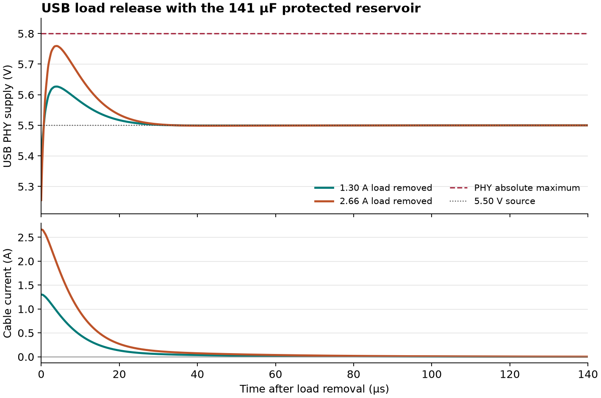

# USB input capacitance, ripple and hot-plug protection

J200 presents **5.7 µF nominal at first contact**. A second reservoir of **141 µF** sits behind a pair of normally-off MOSFETs and a controlled turn-on ramp. With 1.04 A of programmed charging current, the BQ25622 draws most of its switching ripple from its local PMID bypass. The larger protected reservoir addresses slower source disturbances and load removal. The highest protected voltage in the sampled hot-plug and load-removal cases is **5.760 V**, about 40 mV below the radio's absolute maximum. USB suspend, timing at a 5 V supply, component-temperature bounds and PCB parasitics remain release dependencies. [USB schematic](../electronics/usb-input.kicad_sch) · [Reproducible model](usb-input-model.py) · [Charger input analysis](charger-input-ripple.md)

## Capacitance and current paths

| Domain | Fitted parts and capacitance | Source current path |
|---|---|---|
| J200, VBUS_CONN | C202 1 µF directly across VBUS and GND. R204 1 Ω in series with C201 4.7 µF is a separate shunt branch. Both capacitors are 25 V ceramics. | Present immediately. C202 gives a short high-frequency return, R204 dissipates energy in the cable resonance. |
| USB_VBUS, after Q200/Q201 | C800 10 µF/50 V directly at U800 plus C204/C206/C208, three 47 µF/16 V **D-case** molded tantalums, through a common 0.10 Ω R208. | The opposed body diodes block both directions with the FETs off. U203 slews the bank on after a valid connection. The rail remains up for the PHY and retention feed during suspend. |
| VBUS_LIMITED and PMID | C601 1 µF at BQ VBUS. C602 10 µF/50 V and C603 0.1 µF at PMID. | U800 limits startup current. The charger’s internal input transistor and its body diode can charge PMID before active charging begins. Integrated bias curves give approximately 54.7 µC for these three caps at 5.5 V. |
| SYS, logic and LED output | Approximately 91.1 µF on SYS with the haptic reservoir and bypasses fitted, 22 µF at LOGIC_IN and 44 µF in main 3V3 output ceramics. About 991 µF total at LED_5V, including converter bulk and pixel bypasses. | The charger and converters determine upstream loading. The additional 49 µF stores 0.43 mJ at 4.2 V on SYS. Charge it during controlled converter startup, including when the haptic enable is low. The routed-board startup check is open. LED_5V stores approximately 12.4 mJ at 5 V and starts under its own enable and slew control. |

Adding **100 µF directly to J200** would add 550 µC at 5.5 V. The fitted 5.7 µF takes 31.35 µC nominal and 34.49 µC at +10% tolerance. The proposed directly connected 105.7 µF would take 581.35 µC nominal and exceed the USB 2.0 10 µF equivalent-load restriction. A protected 100 µF bank avoids that immediate charge demand if its turn-on is controlled. Reservoir sizing then depends on the interruption duration, ESR and cable response. An isolated 100 µF feeding a 1.04 A step for 10 µs falls 104 mV before ESR. For 141 µF that term is 74 mV. A series 0.10 Ω alone adds 104 mV if all of the step current flows there. Cable, C800 and charger control share the step in the real circuit. [USB 2.0 §7.2.4.1](https://www.usb.org/documents?search=usb+2.0+specification) · [USB-IF inrush interpretation](https://compliance.usb.org/index.asp?Format=Standard&UpdateFile=Electrical)

A first candidate with one 47 µF bulk capacitor and 1 µF C800 reached 5.94 V for sudden removal of the normal 1.30 A input load. Two 47 µF capacitors, 10 µF C800 and 0.15 Ω external damping gave 5.745 V for a 2.66 A fault-load removal with room-temperature ESR, and 5.828 V when the assumed ESR doubled. Three matched, low-profile parts allow a wider ESR and capacitance envelope with 0.10 Ω damping. Their aggregate rated-voltage leakage at 25 °C is 22.5 µA. [KYOCERA AVX TPS ratings, 16 V table](https://datasheets.kyocera-avx.com/TPS.pdf)

## Charging and switching ripple

The calculated example uses 5 V input, 3.52 V SYS, 1.04 A programmed battery current, 0.12 W logic overhead, 0.15 A of 5 V lighting through an assumed 85% efficient converter, 1 µH and 1.5 MHz PWM. The ideal duty cycle is 0.704. The mean inductor current is 1.325 A and the ideal mean Q2 input current is 0.933 A. Cable DC current increases with conversion loss. At higher battery voltage the 1.04 A charging point plus lighting can draw about 1.25 A from the source. Firmware must qualify the current advertisement and reduce the charge or lighting budget on weaker sources. [Charge envelope and converter RMS derivation](charger-input-ripple.md) · [BQ25622 data sheet](https://www.ti.com/lit/ds/symlink/bq25622.pdf)

The example network reconstructs 25 harmonics through 37.5 MHz with an assumed 10 ns edge. Assumed layout inductances are 8 nH for the pair of pass FETs, 5 nH for U800, 3 nH for charger Q1, 0.5–0.8 nH for ceramics and 2 nH for the reservoir branch. Their series resistances are 20, 34 and 26 mΩ for the switches, 4.46 mΩ for each 10 µF ceramic at 1.5 MHz, and 40 mΩ effective ESR for the three tantalums in parallel. R208 adds another 100 mΩ in series. The cable model is 0.15 Ω and 0.7 µH. C602 and C800 each use 7.276 µF typical at 5 V, C601/C202 use 0.825 µF and C201 uses 4 µF. Frequency-independent parasitics and the assumed edge make the reconstructed peak-to-peak values placement estimates. A real MLCC's ESR and a real PCB's current paths depend on frequency. [Samsung C13585 characteristics](https://product.samsungsem.com/mlcc/CL31A106KBHNNN.do) · [Calculation](usb-input-model.py)

| Current path | 1.5 MHz RMS | Estimated AC RMS through 37.5 MHz |
|---|---:|---:|
| Charger high-side switching current, Q2 | 501 mA | 619 mA |
| C602 at PMID | 497 mA | 613 mA |
| C603 at PMID | 4.70 mA | 152 mA |
| C601 at charger VBUS | 26.8 mA | 58.7 mA |
| C800 at protected input | 50.6 mA | 53.2 mA |
| R208 and protected bulk bank | 3.58 mA | 3.67 mA |
| C202 at J200 | 7.91 mA | 7.96 mA |
| R204/C201 raw damping branch | 0.97 mA | 0.97 mA |
| Cable | 0.148 mA | 0.148 mA |

| Rail | 1.5 MHz RMS voltage | Estimated peak to peak, 25 harmonics |
|---|---:|---:|
| J200 raw VBUS | 0.975 mV | 2.77 mV |
| USB_VBUS at PHY/U800 | 0.505 mV | 1.62 mV |
| VBUS_LIMITED | 3.31 mV | 14.5 mV |
| PMID | 4.96 mV | 61.0 mV |

The high-side switch and both local bypasses form the switching loop. The loop currents have different phases, so their RMS magnitudes do not add arithmetically. Device heating scales with RMS current squared times ESR. This example dissipates about 1.68 mW in C602 at the assumed ESR, 13 µW in C800, 1.35 µW in R208, 0.54 µW across the three protected capacitors and 0.94 µW in R204. The sum in the capacitors depends on sharing and frequency-specific ESR. The charge-mode review gives 0.716 A as a screened local full-spectrum demand across component and load tolerances. The model excludes discontinuous-mode operation, PFM bursts, LED load modulation, charger regulation transients and switch-node pickup. [Charger current model and load-step estimates](charger-input-ripple.md)

## Cold attachment

With the FETs off, the model solves a source with series cable L/R, C202 shunting J200 and the R204/C201 series damping branch. It sweeps loop inductance 0.15–2 µH and cable/source resistance 0.08–0.50 Ω, effective C202 0.60–1.20 µF, C201 3.0–5.17 µF and R204 0.99–1.01 Ω. A separate 8.55 µs input-referred pole represents the fast OV divider corner. A 5.5 V source excites the following independent maxima. [Analog Devices AN-88](https://www.analog.com/media/en/technical-documentation/application-notes/an88f.pdf)

| Source rise | Raw VBUS peak | Cable peak | R204 peak power | R204 pulse energy |
|---|---:|---:|---:|---:|
| Ideal step | 7.697 V | 14.03 A | 41.7 W | 85.3 µJ |
| 1 µs | 7.683 V | 11.94 A | 35.0 W | 84.8 µJ |
| 10 µs | 6.635 V | 3.44 A | 7.38 W | 57.1 µJ |
| 100 µs | 5.595 V | 0.36 A | 0.083 W | 7.92 µJ |

U200 VBUS_DET is on the raw side. Its recommended operating maximum is 22 V and its absolute maximum is 28 V. Onsemi lists dead-battery operation on the CC pins. VBUS_DET tolerance does not establish a guaranteed VBUS_DET leakage or phantom-supply limit for every unpowered VDD condition. U203 tolerates positive VIN excursions to 60 V and the FETs are rated 30 V. C201/C202 are rated 25 V. With an illustrative 2 nF total off-state feedthrough and 4.7 µF minimum C800, 7.697 V couples about 3.3 mV onto an initially discharged protected rail. Gate Miller turn-on and PCB coupling require actual layout estimates. R204 is the 2 W Bourns CRM2512. Its single-pulse chart at 100 µs exceeds 300 W for the 1 Ω version. The modeled 41.7 W pulse and 85.3 µJ are within this isolated-pulse screen. [FUSB303B](https://www.onsemi.com/pdf/datasheet/fusb303b-d.pdf) · [LTC4365](https://www.analog.com/media/en/technical-documentation/data-sheets/LTC4365.pdf) · [Bourns pulse curves](https://www.bourns.com/docs/product-datasheets/crm.pdf)

U203 qualifies the input before driving Q200 and Q201 through individual 10 Ω gate stoppers. R211 5.23 kΩ isolates the three parallel 100 nF gate-ramp capacitors during fast turnoff. A separate R214 100 kΩ protects SHDN if VIN swings negative. R205/R206/R207 and C203 give 5.65 V nominal overvoltage trip, approximately 5.526–5.775 V over −40 to +85 °C including specified comparator, divider tolerance, TCR and pin leakage. The nominal OV filter time constant is 9.12 µs. R212/R213 give 3.833 V nominal UV fall and approximately 4.025 V nominal restart. Using divider, input leakage, temperature and hysteresis corners gives 3.704–3.966 V fall and 3.855–4.216 V restart. The PHY can brown out before UV disconnect. The switch must see a valid hysteretic restart condition after a fault. [LTC4365 figures 13–14 and electrical characteristics](https://www.analog.com/media/en/technical-documentation/data-sheets/LTC4365.pdf)

The 151 µF protected nameplate corresponds to 830.5 µC and 2.28 mJ at 5.5 V. The ramp controls the charge rate. At an assumed 30 µA gate-pump maximum, 240 nF minimum effective gate capacitance and a conservative 181 µF protected load (170 µF reservoir plus 11 µF C800), I = Cload × Ig/Cg gives **22.6 mA**. Adding 67 mA U800 cold-limit, 1.674 mA worst retention, 0.4 mA U203 and an illustrative 2.4 mA PHY allowance gives **94.1 mA**, before other leakage and small controls. Revision E selects Samsung CL10B104KB8NNNC (C1591) for all three gates. At a lower assumed total of 210 nF the same screen yields 25.9 mA for the bank and 97.3 mA including the listed loads. Only about 2.7 mA then remains before 100 mA. Initial tolerance, gate bias, aging and temperature still require a combined lower bound. Disable the new display throughout unqualified startup. [Samsung capacitor characteristics](https://product.samsungsem.com/mlcc/CL10B104KB8NNN.do) The published 12–30 µA pump and 26–49 ms recovery delay are specified at 12 V. At nominal 300 nF and 20 µA, traversing an illustrative 6.9 V gate excursion takes 104 ms, plus qualification. At 330 nF and 12 µA the excursion takes 190 ms plus qualification. USB attach timing and inrush-current behavior for this slow ramp must be reconciled with firmware, source detection and dead-battery operation. The default startup current setting must remain in force while ramping. After standalone CC qualification enables a higher source limit, the startup budget changes accordingly. Integrated USB-IF inrush limits apply independently of this nominal current estimate. [LTC4365 gate slew guidance](https://www.analog.com/media/en/technical-documentation/data-sheets/LTC4365.pdf) · [TPS22950-Q1](https://www.ti.com/lit/ds/symlink/tps22950-q1.pdf) · [USB-IF inrush interpretation](https://compliance.usb.org/index.asp?Format=Standard&UpdateFile=Electrical)

The USB 2.0 Connect Timing ECN distinguishes the 1 s powered-peripheral connect deadline from the 100 ms interval a good-battery or bus-powered device may draw up to one unit load before D+ rises. At 330 nF and 12 µA, raising the protected rail through 4.35 V alone takes about 120 ms after conduction begins, before PHY initialization. This exposes a specific possible preconnect timing violation if the bus draw exceeds suspend current for that interval. Bound the actual 5 V pump, FET conduction point, connector current and firmware D+ timing, or separate reservoir charging from the PHY startup path. The ECN has distinct weak/dead-battery rules. [USB-IF USB 2.0 specification bundle](https://www.usb.org/document-library/usb-20-specification) · [Connect Timing ECN, Figure 7-29 and Table 7-14](https://git.nefarius.at/nefarius/USB-Bluetooth-Specs/media/branch/master/usb_20_0702115/Connect%20Timing%20ECN.pdf)

## Already-powered contact and load removal

The model keeps the FETs conducting throughout disturbances. Its six states are cable current, raw voltage, C201 voltage, pass-path current, protected voltage and reservoir voltage. It uses up to 2 µH cable inductance, 0.08–0.50 Ω cable/source resistance, 3–30 nH pass-path inductance and 12–40 mΩ pass resistance. C800 spans 4.7–9 µF. The three tantalums span 106–170 µF collectively, wider than their nominal ±10% at room temperature. The common branch resistance spans 0.098–0.252 Ω including R208 tolerance/TCR, contact and capacitor ESR. At 25 °C the specified capacitor ESR ceiling is 0.150 Ω each at 100 kHz, or 0.050 Ω in parallel. The extreme sample assumes 0.150 Ω aggregate capacitor ESR, three times that ceiling. The supplier’s 25 °C rating does not guarantee this assumed ESR bound at every cable resonance frequency or cold case temperature. Layout and supplier impedance-versus-temperature data must substantiate that bound for release. [TPS data](https://datasheets.kyocera-avx.com/TPS.pdf) · [Model](usb-input-model.py)

| Event ending at 5.50 V, with no clamp action credited | Maximum protected USB_VBUS |
|---|---:|
| Instant source change 4.35 → 5.50 V, zero load | 5.604 V |
| Stress change 3.65 → 5.50 V, zero load | 5.668 V |
| Sudden removal of 1.30 A normal load | 5.627 V |
| Sudden removal of 2.66 A fault-limited load | 5.760 V |
| 4.35 → 5.50 V and 1.30 A removal, arbitrary relative timing | ≤5.650 V |
| 4.35 → 5.50 V and 2.66 A removal, arbitrary relative timing | ≤5.760 V |
| 3.65 → 5.50 V and 1.30 / 2.66 A removal, arbitrary timing | ≤5.713 / 5.760 V |
| Reconnect after sampled 1–150 µs open contacts while 1.30 A discharged the bank, then drop load | 5.656 V |

The curves use the sampled corner giving the highest load-release voltage. Cable L/R are 2 µH and 80 mΩ. The pass path is 30 nH and 12 mΩ. C800 is 4.7 µF effective, the protected reservoir is 106 µF effective with 252 mΩ total branch resistance, and C202/C201/R204 are 0.6 µF, 3 µF and 1.01 Ω. The 5.50 V source remains connected through the event.

The powered source-step cases start in the appropriate loaded equilibrium. For a previous load I, initial raw voltage is Vs − I·Rcable, protected voltage subtracts I·Rpass again, and both inductor currents start at I. The asynchronous upper bound independently aligns the step and release peaks at each physical corner. The 3.65 V source plus substantial load would already lie below UV in steady state. This deliberately extends the fault envelope while the gate might still be high. Open-contact cases preserve individual capacitor voltages and FET current, reset cable current to zero, permit the load to discharge the bank and reconnect at 5.50 V while raw has remained above 3.65 V. The calculation samples a defined set of contact gaps and component corners. Strongly nonlinear source recovery, ESD, extended overvoltage after the trip delay, negative-cable excursions and arbitrary multi-bounce sequences remain outside this model.

Across selected individual and simultaneous waveforms, R208 carries up to 9.184 A for 8.60 W peak and 156 µJ. Independent relative-phase bounds at 3.65 → 5.50 V and 2.66 A release are 10.92 A, 12.16 W and 225 µJ, using an RMS energy norm over the modeled aperture. The 0.10 Ω Bourns resistor’s single-pulse chart exceeds 200 W at 100 µs. Match the three capacitor routes and verify individual surge sharing, pulse repetition, pulse duration and thermal derating. TPS capacitors are surge-tested and operate here below 37% of 16 V even at the modeled protected peak. Each capacitor is rated 1.0 A RMS at 25 °C and 0.90 A at 85 °C at 100 kHz. Those continuous ripple ratings serve a different stress condition from the short surge. [Bourns pulse chart](https://www.bourns.com/docs/product-datasheets/crm.pdf) · [TPS series surge and ripple data](https://datasheets.kyocera-avx.com/TPS.pdf)

## Operating limits and sourcing

- The BMD-340 PHY is specified for 4.35–5.50 V operation with 5.80 V absolute maximum. U800 VIN/ON have a 6.0 V absolute maximum and 5.5 V recommended upper limit. During a positive transient the modeled 5.760 V exceeds both recommended upper limits. Each CSD17309Q3 is specified at 8.5 mΩ maximum at 3 V gate drive and 25 °C. The pair loses 22.1 mV at 1.30 A under those conditions. With 40 mΩ total warm path including interconnect, 4.40 V at J200 gives 4.348 V on the PHY, 2 mV short. Require at least 4.45 V **at J200 under load** for the 1.30 A operating point, or reduce draw as headroom declines. The load budget, copper drop, gate drive and temperature require review at final layout. At precisely 4.35 V at the connector any finite series drop prevents minimum PHY voltage. [BMD-340](https://content.u-blox.com/sites/default/files/BMD-340_DataSheet_UBX-19033353.pdf) · [TI MOSFET](https://www.ti.com/lit/ds/symlink/csd17309q3.pdf) · [TPS22950-Q1](https://www.ti.com/lit/ds/symlink/tps22950-q1.pdf)
- Suspend budget starts with approximately 724 µA after the conservative retention/ON/U800 accounts. Deduct 400 µA combined U203 VIN/VOUT limits, about 9.7 µA total divider current and 22.5 µA room-temperature rated-voltage leakage across C204/C206/C208. **Approximately 292 µA remain** for the radio PHY, detector and other leakage. A typical 262 µA PHY leaves 30 µA. The FUSB303B data lists a typical 72.4 kΩ VBUS leakage resistance in its stated mode, equivalent to 76 µA at 5.5 V if applicable. Simultaneous maximum suspend current is unresolved, particularly at higher temperature and during the minutes after a cold start. [FUSB303B](https://www.onsemi.com/pdf/datasheet/fusb303b-d.pdf) · [USB limit and retention](usb-limit.md)
- New Q200/Q201 use C485528. R204 and R208 use pulse-rated Bourns C840604 and C840603. C204/C206/C208 use C284840 and C800 uses Samsung C13585. All are catalogued for purchase. Catalog or LCSC-stock figures do not reserve JLCPCB assembly stock. The check observed 575 JLC ready C284840, 4,554 ready C840604, 15,755 LCSC C840603 and 88 LCSC C485528. Procurement must allocate three C284840 and two C485528 per board. Verify stock, voltage bias, footprint/terminal numbering and capacitor polarity again when preparing the assembly BOM. [C284840](https://www.lcsc.com/product-detail/C284840.html) · [C840603](https://www.lcsc.com/product-detail/C840603.html) · [C840604](https://www.lcsc.com/product-detail/C840604.html) · [C485528](https://www.lcsc.com/product-detail/C485528.html) · [C13585](https://www.lcsc.com/product-detail/C13585.html)

Run `python3 design/usb-input-model.py` with Python and NumPy 2.x. The reported numbers are circuit-model results. There is no routed PCB or measured USB-compliance result.
